# SharedTeaRoom
共享茶室系统 亮点：DeepSeek茶室助手、ECharts运营分析、预约规则贯穿下单流程、茶室使用闭环、 茶室与配套商品协同；

所有源码均本人开发，项目是前后端分离的，所有的项目都具备了完整的业务逻辑，不仅仅局限于基础的增删改查（CRUD）操作，系统亮点众多。

本文注重于计算机毕业设计选题指导，列出题目均有源码， 大家可以去【公众号】(毕业终点站)获取或者加我【qq】(2112698948)提意见(别忘记Star哟)。备注：git

声明：仅用于学习使用，请勿用于任何商业行为！

1.系统非商用，非开源，非无偿。

2.由本人开发，如需源码，请联系以下方式，qq:2112698948。

3.项目有很多，并未全部上传，如果未找到想要的，可直接咨询

# 共享茶室

> 一套把「订包间」和「买茶点」放在一起的 Web 系统：用户按日期时段预约茶室、在线支付、扫码开门，顺手在商城里加购茶叶茶具；管理员配置时段价格、跟进开锁与清扫状态、维护商品库存，并用图表看各包间的评分和顾客反馈。两个角色共用一套后台。

## 一、系统亮点

**1. 预约规则贯穿下单流程**
管理员按包间、按星期配置可约时段和价格——云水间 48 元/小时，就切成 10:00-12:00 这样的两小时段、每段 96 元；荷风堂 88 元/小时，同长度时段就是 176 元。用户在前台选日期、点时段，系统按所选时段自动算出金额，同时做时间冲突检测，已经约出去的时段不会再出现在可选项里。价格和规则都在后台改，前台下单时直接生效，不用改代码。

**2. 茶室使用全流程**
一笔预约要走过几个状态：提交后待支付，付完变已支付并给出开门二维码；到店扫码，开锁状态从「未开锁」变成「已开锁」；离店后用户上报，清扫状态记一笔；管理员确认清扫并点完成订单，整单结束。用户端订单卡片和管理端列表都并排显示订单状态、开锁状态、清扫状态三列，顾客和商家看到的是同一份进度，不用打电话问「这门开了没有」。

**3. 茶室与配套商品协同**
包间和茶点茶具在一个系统里卖。用户在商城挑西湖龙井、桂花糕、青瓷品茗杯，加购物车结算；订单中心用「预约订单」「商品订单」两个标签分开看，不用在两套系统之间来回跳。管理员这边也是两个入口维护：包间管容纳人数、每小时价格、设施和上下架，商品管分类、价格、库存和上下架。

**4. DeepSeek 茶室助手**
对话入口直接放在顶部导航上，问「喝茶」这种很宽的话也能展开成茶叶种类、茶具选择、冲泡技巧、茶文化故事几个方向，回复走 SSE 流式输出，一个字一个字往上走。左侧留着历史会话，聊过的还能点回去接着问。茶文化这类偏常识的问题，不用再单独去搜。

**5. ECharts 运营分析**
评价分析页把顾客反馈做成六张指标卡加四张图：评价总数、平均评分、好评率、差评率、回复率、今日新增；评分分布环图、各茶室评价数量环图、平均评分排行条形图、评价关键词词云。哪个包间评分掉队、顾客反复提的是茶具还是环境，图上能读出来。词云用 Jieba 分词后交给 echarts-wordcloud 渲染。

## 二、技术选型

| 层次 | 技术 |
| --- | --- |
| 架构 | B/S、MVC、前后端分离（用户网页端 + 管理后台） |
| 开发环境 | Windows、IDEA、JDK 17、Maven、MySQL 8、Node.js |
| 后端 | Java 17、Spring Boot 3.3.1、Spring MVC、MyBatis-Plus 3.5.7、JWT |
| 前端 | Vue 3.5.13、Vite 5、Element Plus 2.5.1、Vue Router、Pinia、Axios、Sass |
| 数据可视化 | ECharts 5.5.1、echarts-wordcloud |
| AI 与文本分析 | DeepSeek API、SSE 流式回复、历史会话管理、Jieba 中文分词 |

## 三、角色与功能

| 角色 | 主要功能 |
| --- | --- |
| 管理员 | 数据统计与评价分析；账号管理；茶室包间维护（人数、时价、设施、图片、上下架）；预约规则与按星期的时间段价格配置；预约订单管理（开锁状态、清扫状态、完成订单）；商品分类、商品管理、商品订单（明细与发货）；轮播图、店铺公告、店铺信息；评价管理与商家回复、收藏管理 |
| 普通用户 | 注册登录、首页轮播；茶室列表筛选与详情、收藏；按日期与时段预约、模拟支付、开门二维码、取消预约；我的订单（预约订单 / 商品订单）；AI 对话与历史会话；精选商城与购物车；个人中心、我的评价 |

## 四、系统截图

> 源文档共 17 张截图，这里挑选 15 张核心页面按两角色分区展示。个人中心、购物车等页面未全部列出，功能已在上方角色表覆盖。源文档未提供独立的系统总览图，下方从登录入口开始。

### 登录入口

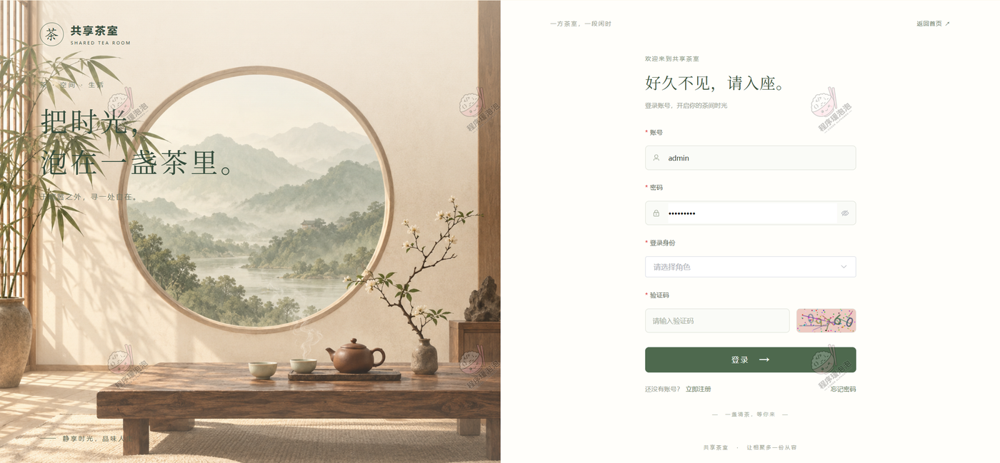

**登录页**：左边是品牌区和茶席场景，标语「把时光泡在一盏茶里」；右边填账号、密码，下拉选择登录身份，再输验证码。管理员和普通用户从同一个入口进，按所选身份进入不同界面。

### 用户端

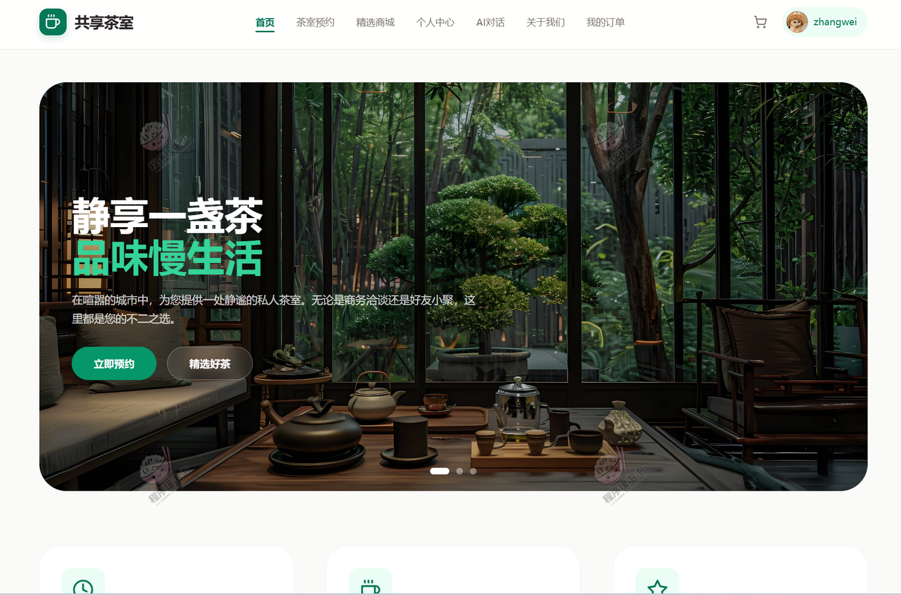

**首页**：顶部导航是首页、茶室预约、精选商城、个人中心、AI对话、关于我们、我的订单，右侧是购物车和当前用户。中间的大图轮播压着「静享一盏茶」「品味慢生活」两行主文案，下面挂「立即预约」和「精选好茶」两个入口，分别对订包间和买东西。

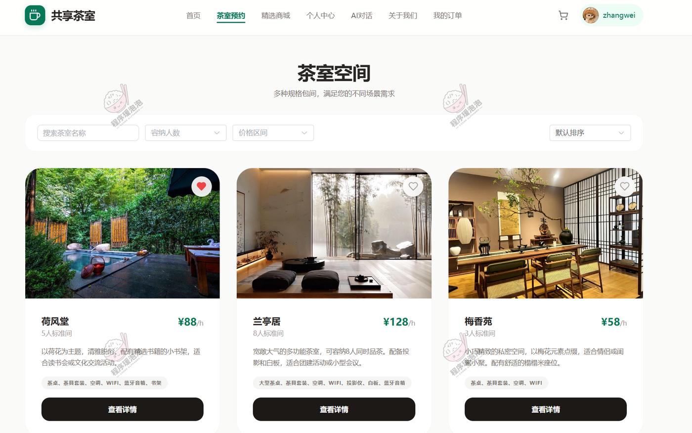

**茶室空间**：顶部可以按名称搜、按容纳人数和价格区间筛，也能切排序方式。三列卡片是荷风堂 88 元/小时坐 5 人、兰亭居 128 元/小时坐 8 人、梅香苑 58 元/小时坐 3 人，每张标了茶点、茶具套装、空调、WIFI、投影仪这类设施标签，右上角能直接收藏。

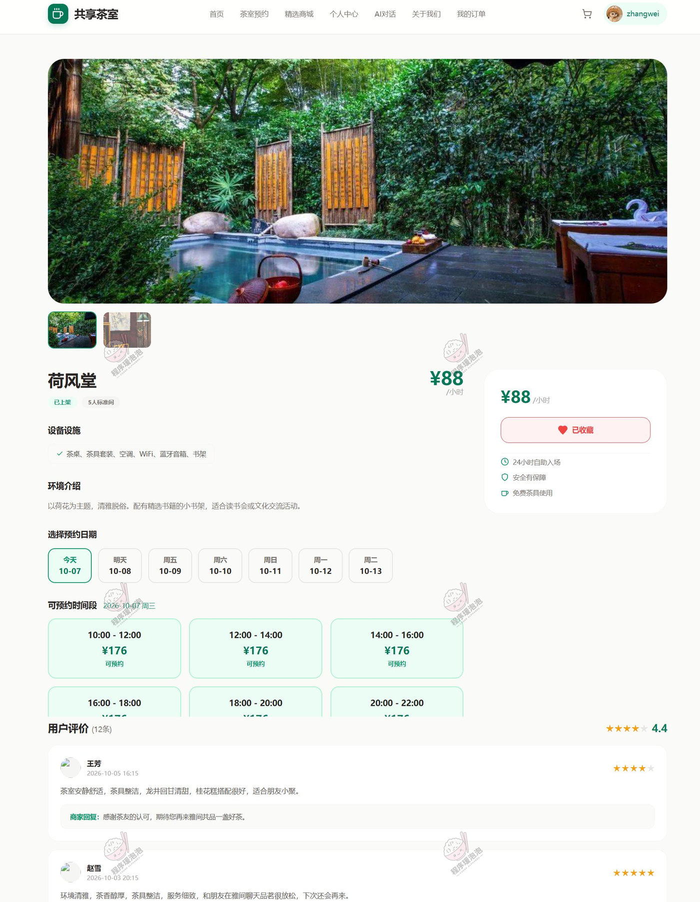

**茶室详情与预约**：以荷风堂为例，右侧报价 88 元/小时，下面列了 24 小时自助入场、安全有保障、免费茶具使用三项权益，以及设备设施和环境介绍。往下是预约区：先选日期（今天到 10-13 排成一行），再选当天时段，10:00-12:00、12:00-14:00 一直到 20:00-22:00 共六个两小时段，每段标价 176 元，正好是两小时的价格。底部是 12 条用户评价，均分 4.4，带商家回复。

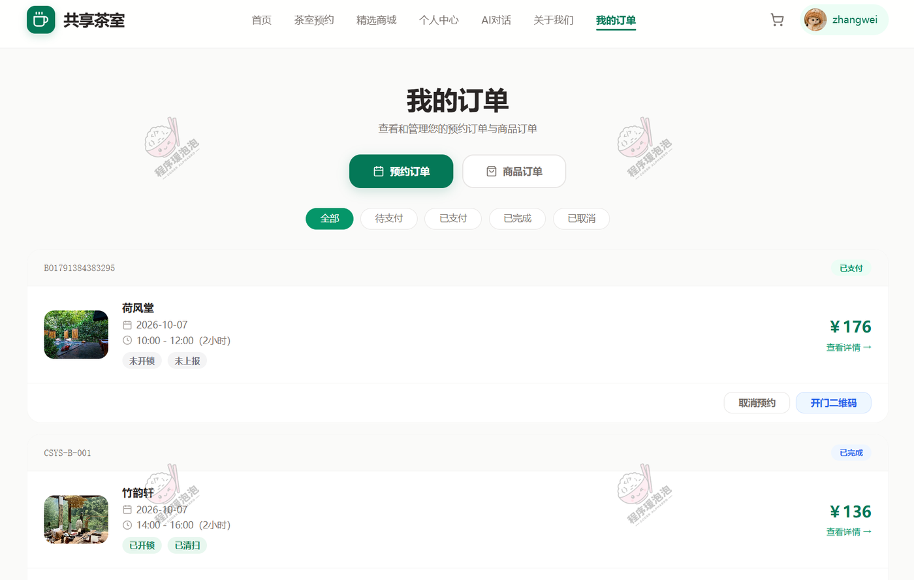

**我的订单 · 预约订单**：状态标签分全部、待支付、已支付、已完成、已取消。每张订单卡带订单号、茶室、预约日期、时段和时长、金额，标签区并排显示「未开锁 / 未上报」或「已开锁 / 已清扫」，右侧按钮是「取消预约」和「开门二维码」——扫码开门这一步就从这里进。

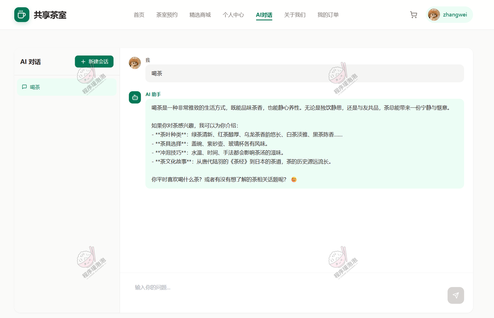

**AI 对话**：左侧是「新建会话」按钮和会话列表，右侧是对话窗口。截图里问的是一句「喝茶」，回复把茶叶种类、茶具选择、冲泡技巧、茶文化故事四块分开讲，末尾还反问平时喜欢喝什么茶。回复是流式输出的，底部常驻输入框。

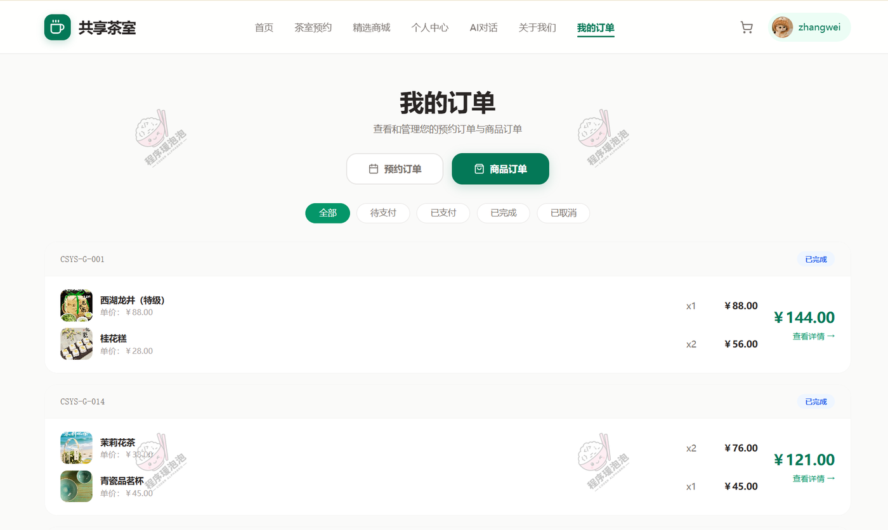

**我的订单 · 商品订单**：和预约订单同一个页面，切到商品标签就是买的东西。CSYS-G-001 是西湖龙井 88 元加桂花糕 28 元两份，合计 144 元；CSYS-G-014 是茉莉花茶 38 元两份加青瓷品茗杯 45 元，合计 121 元。茶叶、茶点、茶具混在一单里结算。

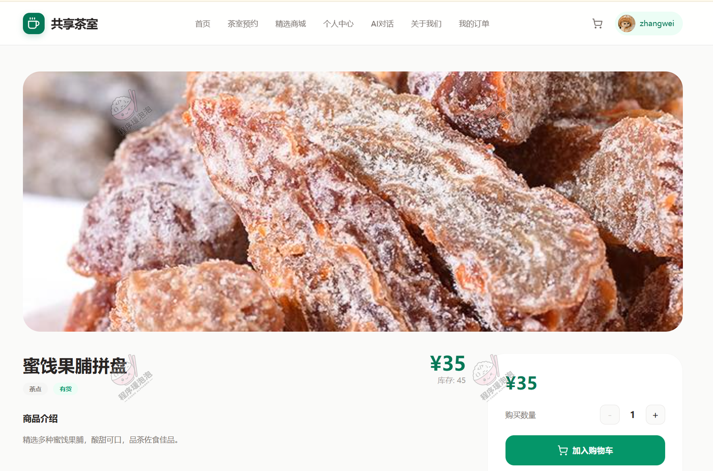

**商品详情**：蜜饯果脯拼盘，标价 35 元、库存 45，分类是茶点且显示「有货」，下面是商品介绍。右侧可以调购买数量，直接加入购物车。配套商品的购买路径和普通商城一样，不需要先订包间。

### 管理员端

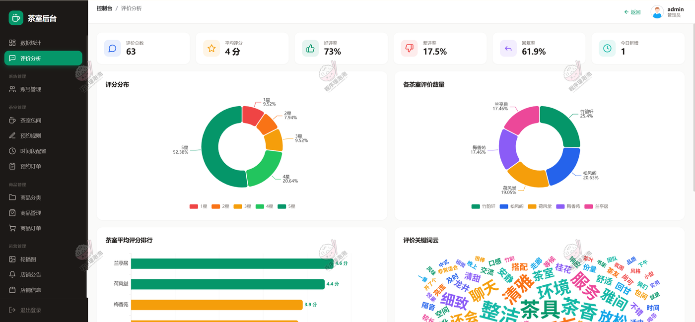

**评价分析**：顶部六张指标卡——评价总数 63、平均评分 4 分、好评率 73%、差评率 17.5%、回复率 61.9%、今日新增 1。左边评分分布环图里 5 星占 52.38%、4 星 20.64%；右边各茶室评价数量，竹韵轩 25.4% 最多，松风阁 20.63% 次之；左下是平均评分排行，兰亭居 4.6 分、荷风堂 4.4 分、梅香苑 3.9 分；右下是评价关键词词云，茶香、茶具、环境、服务、雅间这些词最大。

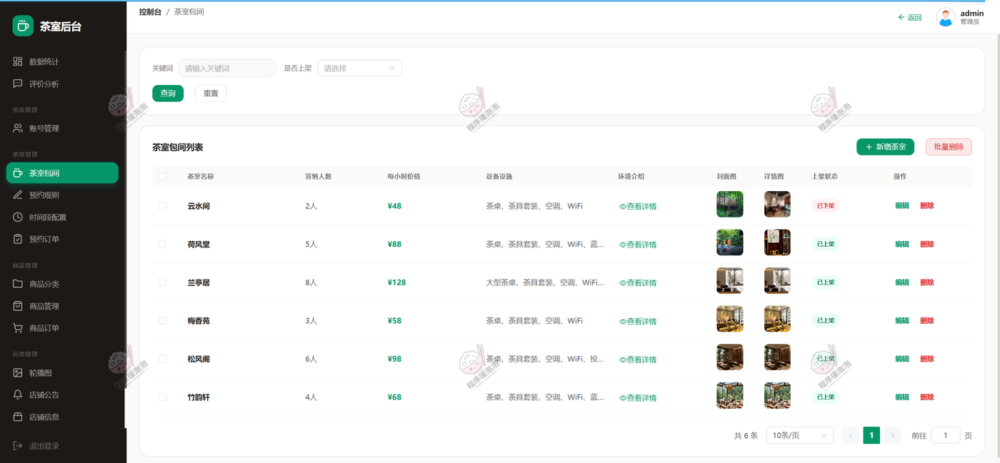

**茶室包间**：六个包间一屏列完——云水间 2 人 48 元、荷风堂 5 人 88 元、兰亭居 8 人 128 元、梅香苑 3 人 58 元、松风阁 6 人 98 元、竹韵轩 4 人 68 元。表格直接管容纳人数、每小时价格、设备设施、环境介绍、封面图和详情图，以及上架状态（云水间当前是已下架）。

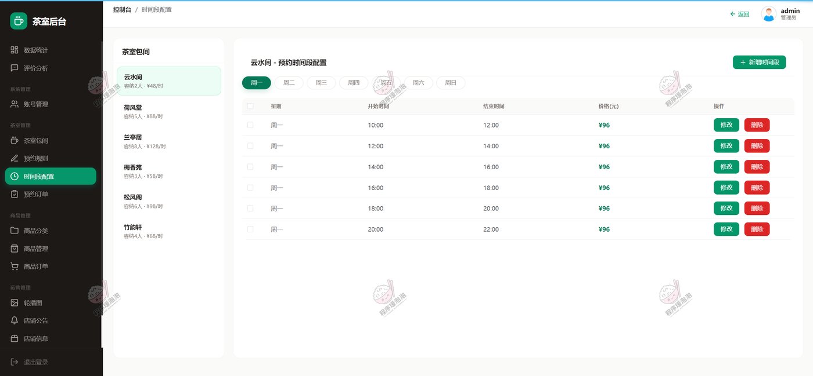

**时间段配置**：左边选包间（每个都标着时价），右边配这个包间的可约时段。上面是周一到周日七个标签，下面是当天的时段表：开始时间、结束时间、价格。截图里云水间的周一排了六个两小时段，每段 96 元，行尾可以改可以删，右上角还能新增时段。价格就是在这里改的。

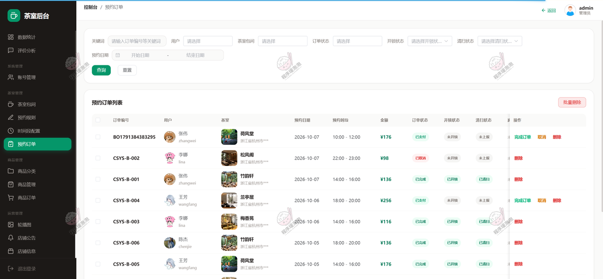

**预约订单**：可以按订单号关键词、用户、包间、订单状态、开锁状态、清扫状态和预约日期筛。表格把三个状态分开列——已支付但未开锁未上报的、已完成且已开锁已清扫的，看这三列就知道每单走到哪一步。行操作是完成订单、取消、删除。

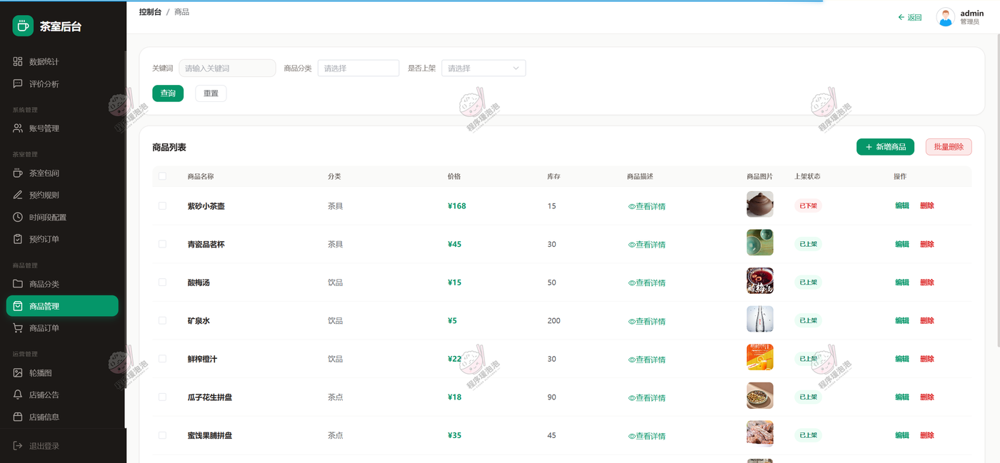

**商品管理**：茶具、饮品、茶点三类共七件商品，列表里是价格、库存、商品描述、图片和上架状态。紫砂小茶壶 168 元库存 15 件、当前已下架；青瓷品茗杯 45 元、蜜饯果脯拼盘 35 元库存 45，都在架上。

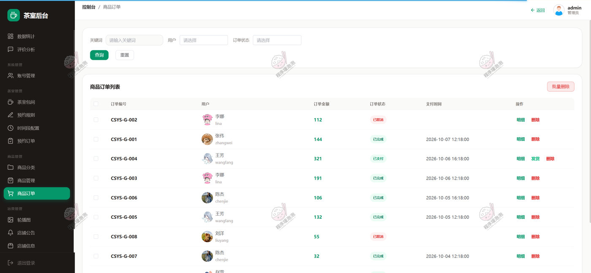

**商品订单**：列出订单号、用户、订单金额、订单状态和支付时间，可以按用户和状态筛。大部分行是「明细 / 删除」，待发货的订单会多一个「发货」按钮。金额从 32 元到 321 元不等，茶叶礼盒这类客单价明显高于单份茶点。

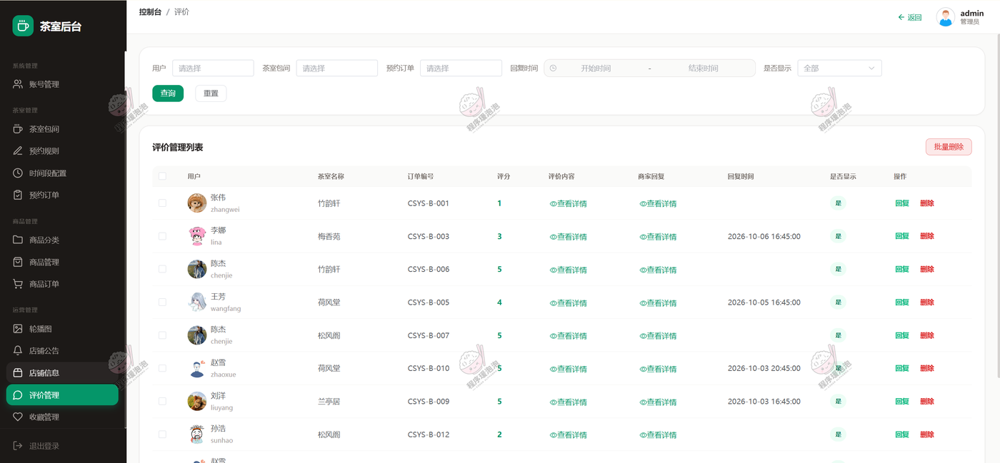

**评价管理**：按用户、包间、预约订单、创建时间筛，也可以只看未显示的。表格列出评分、评价内容、商家回复、回复时间和是否显示，行操作是回复和删除。截图里竹韵轩有一单打了 1 分，另一单 5 分，评价分析里的差评率就是这么攒出来的。

## 五、说明

- 截图数据来自演示环境，订单金额、评分、库存等数值仅作展示；支付与开门均为模拟流程，不对接真实支付渠道和门锁设备。
- 文档展示 15 张截图，需要了解更多，请联系我。
